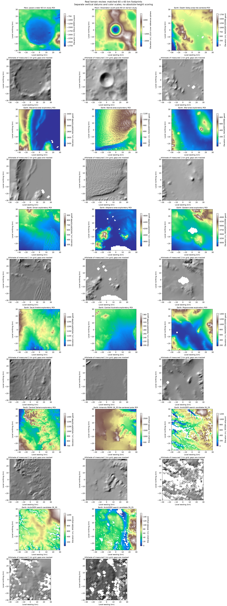

# Current validation

The catalog now includes Mars and Moon references and 15 Earth profiles (14 QA-approved).
See [challenge progress](challenge-progress.md) and the linked current CSVs for
new results, source interpretation and remaining limits. The prior eleven-site
report below records the preceding milestone; its counts and lunar blocker are historical.

# Real Mars/Earth catalog validation

## Outcome

**One measured Mars reference and eleven distinct Earth profiles are prepared.**
All eleven Earth sites pass the 90% valid-cell threshold and have all four terrain
features available. The reference is the 60 x 60 km Jezero study region, centered at
18.41 N, 77.69 E (Mars planetocentric coordinates). Earth regions use WGS84 and
tile-midpoint centers verified against NASA CMR. Every region uses a 1000 m
analysis grid and 3 x 3 cell roughness window. Footprints were fixed before scores.

## Rankings against Jezero

| Rank | Earth study region | Similarity index / 100 | Valid ground coverage |
| ---: | --- | ---: | ---: |
| 1 | Mojave-area exploratory ROI | 99.0198 | 99.889% |
| 2 | Atacama-area exploratory ROI | 94.4211 | 99.694% |
| 3 | Death Valley-area tile-centered ROI | 94.0643 | 99.778% |
| 4 | Qaidam-area exploratory ROI | 92.6258 | 97.639% |
| 5 | Central Sahara exploratory ROI | 89.3544 | 100.000% |
| 6 | Afar-area exploratory ROI | 85.8371 | 100.000% |
| 7 | Namib-area exploratory ROI | 85.5257 | 100.000% |
| 8 | Altiplano-area exploratory ROI | 80.7141 | 95.222% |
| 9 | Oman exploratory ROI | 80.6242 | 100.000% |
| 10 | Saudi Arabia exploratory ROI | 79.4920 | 100.000% |
| 11 | Central Australia exploratory ROI | 76.3951 | 100.000% |

These are the closest matches among this catalog under scoring_v1 engineering
weights and tolerances. Scores are not probabilities or expert certification.
Four aggregate features do not compare crater morphology or landform arrangement.

## Download inspection and provenance

The user supplied thirty extracted files in `data/raw/Earth/NASADEM_archives/`:
ten HGT, ten SWB and ten NUM files. Each HGT is 25,934,402 bytes; each SWB/NUM
is 12,967,201 bytes. HGT is 3601 x 3601 int16 on the expected WGS84 one-arcsecond
grid with EGM96 metre heights. Raster centers match the CMR granules. Elevation
contains valid samples and all SWB classes are 0=land or 255=water.

All member SHA256 checksums are registered in [sources.csv](../data/metadata/sources.csv),
which now contains 34 records (MOLA plus 33 Earth members). Original files were
read directly and preserved. The original ZIPs were not supplied, so ZIP CRC and
independent publisher archive checksums are **unverified**. File sizes, decoding,
mask classes and local hashes support usability and reproducibility; they do not
independently establish archive authenticity. Original download dates are unknown;
manifest access dates record verification time.

The complete MOLA source image was previously matched by SHA256 against the PDS
archive; its XML interpretation uses the precise PDS4 grid and keeps valid zero
elevations. MOLA contains interpolated bins, so nonmissing raster coverage does
not establish direct altimeter-shot coverage. Earth water masks are applied before
area aggregation; partially unsupported metric cells remain masked.

## Verification

- Independent scalar feature calculations agree within 1e-8 for every profile.
- Maximum absolute feature difference: 3.55e-15.
- Repeated source-to-grid preparation is exactly deterministic, including masks.
- Independent scoring, eligibility, tie ordering and complete rank order agree.
- Full candidate rankings are recorded for each weight perturbation and ablation.
- AppTest verifies real ranked-table/CSV parity and Moon stale-result blocking.
- 73 automated tests pass; Ruff checks pass.



Each panel has a separate elevation scale and vertical datum. Absolute heights
are not compared in the similarity score. The contact sheet is a review aid,
not an independent certification of location or scientific analog suitability.

## Reproduce

```powershell
.venv/Scripts/python.exe scripts/expand_earth_catalog.py --register --build
.venv/Scripts/python.exe -m pytest -q
.venv/Scripts/python.exe -m ruff check .
```

The importer accepts original ZIPs or complete extracted HGT/SWB/NUM sets. It is
resumable, preserves registered study identities and refuses changed source bytes.
Do not run the original `prepare_real_slice.py` bootstrap on the expanded study.

## Evidence and remaining limits

- [Unrounded analysis CSV](../data/processed/real_analysis.csv)
- [Numerical validation and sensitivity rankings](../data/processed/real_validation.json)
- [Processing manifest with code/input/grid hashes](../data/processed/processing_manifest.json)
- [Acquisition/member checksum report](../data/metadata/earth_acquisition_status.json)
- [Earth footprints](../data/catalog/earth_sites.geojson)

The Mars/Earth catalog is operational. The full two-body release is still blocked
by the damaged lunar raster and missing lunar profile. Independent expert/literature
assessment and separated calibration/evaluation regions remain required for claims
about scientific analog suitability. Worldwide terrain discovery is outside this
preselected catalog comparison.
